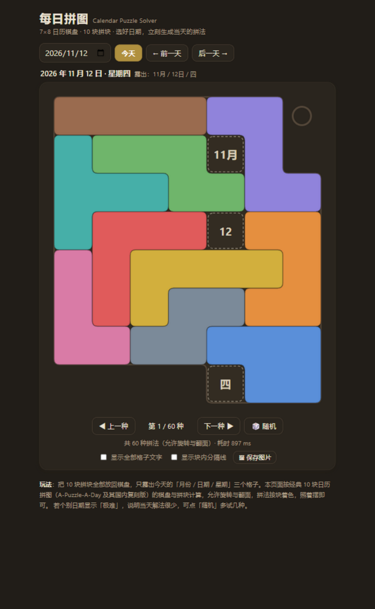

# 每日拼图 · Calendar Puzzle Solver

一个**纯前端、零依赖、单文件**的日历拼图解算器 —— 选好日期，立刻算出当天怎么摆。



## 这是什么

「日历拼图」是经典实体益智玩具：把 10 块拼块全部放回 8×7 棋盘，**只露出今天的「月份 / 日期 / 星期」三个格子**。每天一个新挑战，但实体玩具经常摆不出来。

本项目把这件事搬到了网页上：自动求解当天拼法、统计全部摆法数量、逐个浏览、一键导出图片，从此再也不用对着实物发呆。

## ✨ 功能特性

- 🧩 **秒级求解** —— 位掩码 + 记忆化剪枝的精确覆盖求解器，当天拼法通常 1 秒内出结果
- 🔢 **全部拼法统计** —— 列出当天所有摆法（上限 1000 种），「上一种 / 下一种 / 随机」自由浏览，支持 `←` `→` 键盘切换
- 🎨 **SVG 矢量渲染** —— 多连方圆角轮廓、按块着色，照着摆即可
- 🌙 **深色模式** —— 自动跟随系统外观
- 🖼 **导出 PNG** —— 一键保存当前拼法（2× 分辨率）
- ⚡ **Web Worker 后台计算** —— 界面不卡顿；Worker 不可用时自动回退主线程
- 📦 **零依赖** —— 单个 HTML 文件，无构建、无框架、无网络请求，完全离线可用

## 🚀 快速开始

**方式一（最简单）**：下载 `index.html`，双击用浏览器打开即可。

**方式二**：克隆仓库后本地运行：

```bash
git clone https://github.com/TongCL/calendar-puzzle-solver.git
cd calendar-puzzle-solver
# 直接双击 index.html，或起一个静态服务器：
python -m http.server 8000
# 浏览器访问 http://localhost:8000
```

也可以直接部署为 **GitHub Pages**（仓库设置 → Pages → 分支选择 `main` / 根目录）。

## 🎮 使用说明

| 操作 | 方式 |
|---|---|
| 选日期 | 日期输入框直接选，或「今天 / 前一天 / 后一天」按钮 |
| 切换拼法 | 「◀ 上一种 / 下一种 ▶ / 🎲 随机」按钮，或键盘 `←` `→` |
| 显示格子文字 | 勾选「显示全部格子文字」可看清每块覆盖了哪些日期 |
| 显示分隔线 | 勾选「显示块内分隔线」可看出每个拼块的格子构成 |
| 保存图片 | 点「🖼 保存图片」导出当前拼法的 PNG |

> 个别日期解法极少（页面标注「极难」），可以点「随机」多试几种摆法。

## 🧠 工作原理

**问题本质**：50 个有效格（8×7 棋盘去掉 6 个缺口）中，每天固定露出 3 格（月份/日期/星期），剩余 47 格需要由 10 块拼块（7 块五格 + 3 块四格 = 47 格）**不重不漏地精确覆盖**。

求解器（`index.html` 内 `solveDate`）的主要设计：

1. **摆放预生成** —— 每块 8 种旋转/翻面去重后枚举所有平移位置；每个摆放用两个 32 位整数的位掩码（50 格拆成 25+25 的 lo/hi）表示，规避 BigInt 开销。
2. **候选排序** —— 每层 DFS 填最靠前的空格，候选摆放按「该拼块剩余可行摆放数」升序尝试（最受限的先放），更快碰到可行解。
3. **子集和可行性剪枝** —— 预计算每个「剩余拼块集合」能凑出的全部面积（`SUMS` 位集），搜索中对每个空白连通区做洪水填充，面积凑不出来的分支直接剪掉。
4. **失败状态记忆化** —— 相同的（棋盘占用位图，已用拼块集合）组合记入 `fail` 表，重复出现直接返回。
5. **工程包装** —— 求解放入 Web Worker（默认 5 秒时限 / 1000 解上限）：找到首个解立即流式渲染，统计完成后更新总数；Worker 创建失败自动回退主线程；结果按日期缓存，翻日回看零等待。

页面加载时会对当天日期做一次**结构自检**（47 格全覆盖、露出格与日期一致）。控制台还暴露了调试接口：

```js
__cal.solve(2026, 11, 12)   // → { count: 总拼法数, ms: 耗时, holes: 露出格 }
```

## 📁 目录结构

```
calendar-puzzle-solver/
├── index.html        # 全部代码：页面 + 样式 + 求解引擎 + 渲染（单文件）
├── docs/
│   └── screenshot.png
├── ATTRIBUTION.md    # 引用说明：玩法来源与本项目相对其做的更改
├── LICENSE           # MIT
└── README.md
```

## 📖 引用与致谢

本项目代码为原创实现，未复制任何第三方项目的代码。拼图玩法与棋盘规格参考自经典实体玩具 **A-Puzzle-A-Day** 及其国内 10 块复刻版 —— 感谢原设计者带来的好玩具。

玩法来源、权利归属与本项目相对参考对象所做的全部更改，详见 [ATTRIBUTION.md](ATTRIBUTION.md)。

## License

[MIT](LICENSE) © 2026 TongCL
